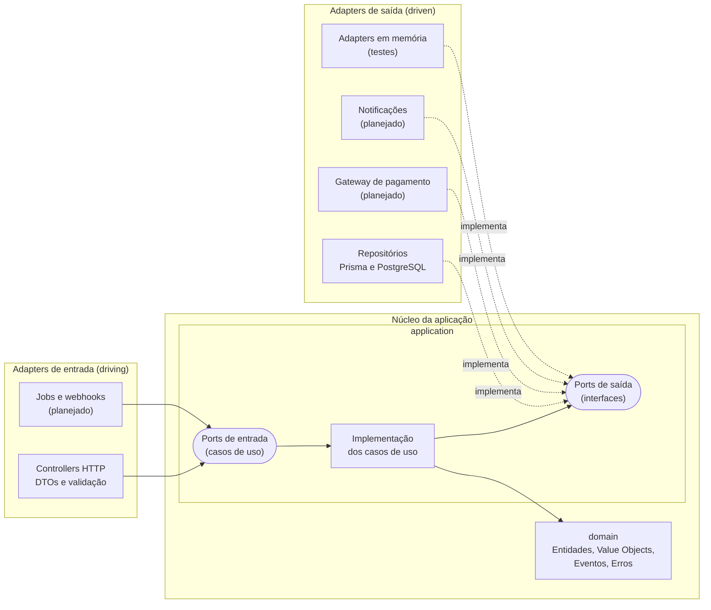
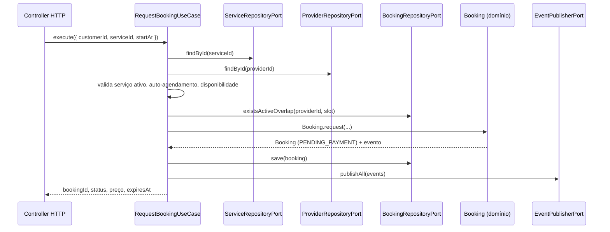

# Arquitetura

Este documento descreve como o projeto está organizado, quais regras governam as dependências entre as camadas e como cada decisão se conecta ao objetivo do sistema.

> Itens marcados como **(planejado)** ainda não estão implementados.

---

## 1. Visão geral

O projeto usa **Arquitetura Hexagonal** (também chamada de *Ports and Adapters*), combinada com conceitos de **DDD tático** (entidades, value objects, agregados e eventos de domínio).

A ideia central é separar o que **o negócio faz** do **como a tecnologia entrega isso**:

- O **núcleo** contém as regras de negócio. Ele é TypeScript puro.
- Os **ports** são interfaces que o núcleo declara para dizer o que precisa do mundo externo ("preciso salvar um agendamento", "preciso cobrar um pagamento").
- Os **adapters** são as implementações concretas desses ports (Prisma, Stripe, HTTP, e-mail).

O ganho prático é poder trocar tecnologias sem tocar nas regras de negócio, e testar o núcleo em milissegundos, sem banco nem framework.

---

## 2. Diagrama



Leitura do diagrama: as setas sólidas mostram quem **chama** quem. As setas tracejadas mostram quem **implementa** um port. Perceba que os adapters de saída apontam para o núcleo (implementam interfaces definidas por ele), e nunca o contrário. Isso é a **inversão de dependência**.

---

## 3. Camadas

| Camada | Responsabilidade | Pode importar | Não pode importar |
|---|---|---|---|
| `domain` | Regras de negócio: entidades, value objects, eventos e erros de domínio | Apenas outros arquivos do próprio `domain` | NestJS, Prisma, Express, `application`, `infrastructure` |
| `application` | Orquestra o fluxo: casos de uso e declaração dos ports | `domain` | NestJS, Prisma, `infrastructure` |
| `infrastructure` | Adapters: HTTP, persistência, pagamento, notificações | `application`, `domain`, frameworks e bibliotecas | Nada é proibido, mas ninguém de dentro o importa |

### domain

Contém o vocabulário e as regras do negócio.

- **Value Objects** (`Money`, `TimeSlot`): imutáveis, validam a si mesmos na criação e não têm identidade.
- **Aggregate Root** (`Booking`): garante que as invariantes sejam sempre respeitadas. Só se altera o estado por meio de métodos com intenção de negócio (`Booking.request()`, e futuramente `confirm()`, `cancel()`, `complete()`).
- **Eventos de domínio**: fatos ocorridos (`BookingRequested`), registrados pelo agregado e publicados depois da persistência.
- **Erros de domínio**: classes que estendem `DomainError`, sem acoplamento a HTTP.

### application

Cada **caso de uso** é uma classe com um método `execute(input)`. Ele recebe dados simples, carrega o que precisa através de ports, invoca o domínio, persiste e publica eventos. Não sabe se foi chamado por HTTP, fila ou teste.

Dois tipos de port:

- **Ports de entrada (driving):** o contrato do caso de uso, chamado por controllers e jobs.
- **Ports de saída (driven):** o que o caso de uso precisa do mundo externo.

### infrastructure

Onde mora tudo que depende de tecnologia.

- `in/http`: controllers do NestJS, DTOs com validação, guards.
- `out/persistence`: repositórios Prisma que implementam os ports de persistência.
- `out/payment`, `out/notification` **(planejado)**.

---

## 4. Regra de dependência

> **As dependências sempre apontam para dentro.** `infrastructure` conhece `application`, que conhece `domain`. O inverso nunca acontece.

Por que isso importa:

- Mudar o banco, o framework ou o gateway não exige alterar regra de negócio.
- O domínio pode ser testado isoladamente.
- Fica claro onde cada tipo de código deve ficar.

### Como é garantida

A regra é verificada automaticamente pelo **oxlint**, com a regra `no-restricted-imports` configurada por camada no arquivo `.oxlintrc.json`:

- Arquivos em `src/modules/*/domain/**` não podem importar `@nestjs/*`, `@prisma/*`, nem caminhos que contenham `application`, `infrastructure` ou `generated`.
- Arquivos em `src/modules/*/application/**` não podem importar `@nestjs/*`, `@prisma/*`, nem caminhos que contenham `infrastructure` ou `generated`.

Violações fazem o `npm run lint` falhar, o que impedirá o merge quando a CI estiver configurada. Veja o [ADR 0003](adr/0003-regra-de-dependencia-via-lint.md).

---

## 5. Ports e adapters

### Ports de saída previstos para o contexto Booking

| Port | Responsabilidade | Adapter de produção | Adapter de teste |
|---|---|---|---|
| `BookingRepositoryPort` | Salvar e consultar agendamentos; verificar conflito de horário | Repositório Prisma (planejado) | In-memory |
| `ServiceRepositoryPort` | Consultar dados do serviço (projeção mínima) | Prisma (planejado) | Stub |
| `ProviderRepositoryPort` | Consultar prestador e sua disponibilidade | Prisma (planejado) | Stub |
| `ClockPort` | Fornecer a data/hora atual | Relógio do sistema | Relógio fixo |
| `IdGeneratorPort` | Gerar identificadores | UUID | Sequencial |
| `EventPublisherPort` | Publicar eventos de domínio | Event emitter ou fila (planejado) | Spy em memória |
| `PaymentGatewayPort` | Cobrar e reembolsar | Gateway real (planejado) | Fake |
| `NotificationPort` | Enviar e-mail ou SMS | SMTP (planejado) | Console |

### Por que `Clock` e `IdGenerator` são ports

Regras que dependem de "agora" ou de IDs aleatórios ficam impossíveis de testar de forma determinística. Com esses ports, o teste injeta um relógio fixo e IDs sequenciais, e o resultado é sempre o mesmo.

### Projeções entre contextos

O contexto Booking não importa entidades do Catalog. Ele define suas próprias projeções mínimas (`ServiceView`, `ProviderView`) com apenas os dados de que precisa. Isso mantém os contextos desacoplados: mudanças internas no Catalog não propagam para o Booking.

---

## 6. Organização por módulos

Cada contexto delimitado vira um módulo, com suas próprias camadas:

```
src/modules/booking/
├── domain/
│   ├── shared/              # DomainError, Money, AggregateRoot
│   ├── events/
│   ├── time-slot.ts
│   └── booking.ts
├── application/
│   ├── ports/
│   │   ├── in/              # Contratos dos casos de uso
│   │   └── out/             # Contratos de persistência e serviços externos
│   └── use-cases/
└── infrastructure/
    ├── in/http/             # Controllers e DTOs
    └── out/persistence/     # Repositórios Prisma
```

Contextos planejados: `identity`, `catalog`, `booking`, `payment`, `review`. Detalhes em [domain.md](domain.md).

### Ligação com o NestJS (planejado)

O NestJS entra apenas na camada de infraestrutura. Os casos de uso são classes TypeScript puras, e a injeção de dependência é feita por **tokens**, associando cada port ao seu adapter dentro do módulo Nest:

```ts
// Exemplo de como a ligação funcionará
{ provide: BOOKING_REPOSITORY, useClass: PrismaBookingRepository }
```

Assim, os casos de uso não precisam de decorators do framework.

---

## 7. Fluxo de uma requisição (exemplo: solicitar agendamento)



O `customerId` vem sempre do token de autenticação, nunca do corpo da requisição. O caso de uso não sabe que existe HTTP.

---

## 8. Estratégia de testes

| Nível | O que testa | Dependências reais | Velocidade |
|---|---|---|---|
| Unitário de domínio | Value objects e agregados | Nenhuma | Milissegundos |
| Unitário de casos de uso | Fluxos de aplicação com adapters em memória | Nenhuma | Milissegundos |
| Integração **(planejado)** | Repositórios Prisma contra um PostgreSQL real (Testcontainers) | Banco | Segundos |
| E2E **(planejado)** | Endpoints HTTP completos | Banco e app | Segundos |

A pirâmide é intencional: a maior parte das regras é verificada nos níveis mais baratos, e os níveis caros cobrem apenas a "cola" entre as peças.

---

## 9. Preocupações transversais

### Concorrência e double booking

Verificar conflito com `existsActiveOverlap` e depois salvar não é atômico: dois pedidos simultâneos podem passar na checagem. A defesa definitiva será uma **exclusion constraint** no PostgreSQL, que impede sobreposição de intervalos por prestador entre reservas ativas. O adapter de persistência converterá a violação em `SlotAlreadyTakenError`. A checagem no caso de uso permanece para dar feedback rápido, e o banco garante a integridade. **(planejado)**

### Consistência entre persistência e eventos

Hoje o evento é publicado logo após o `save`. Em produção, o padrão **Outbox** garantiria que persistência e publicação não divirjam. **(planejado)**

### Fuso horário

Datas são tratadas em UTC. A jornada de trabalho do prestador ("9h às 18h") precisará de um fuso associado ao `Provider`. **(planejado)**

### Segurança **(planejado)**

- Autenticação JWT com access e refresh token (rotação e revogação).
- RBAC (cliente, prestador, admin) por guards.
- Prevenção de IDOR: toda operação verifica se o usuário autenticado é o dono do recurso.
- Hash de senha com Argon2, rate limiting, Helmet e CORS configurado.
- Validação rigorosa de entrada e segredos apenas por variáveis de ambiente.
- Idempotência nas operações de pagamento.

### Configuração

As variáveis de ambiente são validadas com Zod na inicialização (`src/config/env.ts`). Se algo estiver faltando ou inválido, a aplicação não sobe, evitando falhas silenciosas em runtime.

---

## 10. Decisões registradas

| ADR | Decisão |
|---|---|
| [0001](adr/0001-arquitetura-hexagonal.md) | Arquitetura hexagonal com DDD tático |
| [0002](adr/0002-prisma-e-postgresql.md) | PostgreSQL e Prisma 7 |
| [0003](adr/0003-regra-de-dependencia-via-lint.md) | Regra de dependência verificada por lint |
