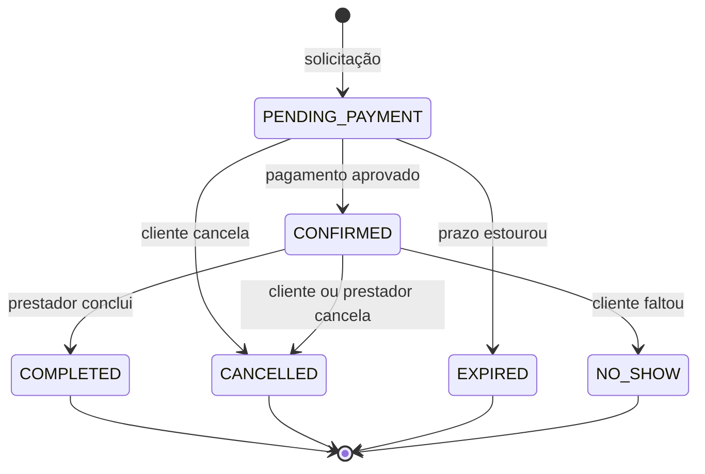

# Modelo de domínio

Este documento descreve o negócio que a API resolve: contextos, agregados, value objects, estados, regras (invariantes), eventos e casos de uso.

> Itens marcados como **(planejado)** ainda não estão implementados. A seção de casos de uso indica o status de cada um.

---

## 1. Visão do negócio

Um **marketplace de serviços** conecta dois tipos de usuário:

- **Prestador:** publica serviços (ex: corte de cabelo, aula de personal), define sua jornada de trabalho e a política de cancelamento.
- **Cliente:** escolhe um serviço, reserva um horário disponível e paga.

O sistema precisa garantir que um horário nunca seja vendido duas vezes, que o dinheiro seja tratado com precisão e que cancelamentos sigam regras claras de reembolso.

---

## 2. Linguagem ubíqua (glossário)

| Termo | Significado |
|---|---|
| **Serviço** | O que o prestador oferece, com duração, preço e política de cancelamento |
| **Agendamento** (*Booking*) | A reserva de um horário de um prestador por um cliente |
| **Horário** (*TimeSlot*) | Intervalo com início e fim |
| **Jornada de trabalho** | Dias e horas em que o prestador atende |
| **Política de cancelamento** | Regra que define quanto é reembolsado conforme a antecedência do cancelamento |
| **Reembolso** | Devolução total ou parcial do valor pago |
| **Expiração** | Perda automática da reserva por falta de pagamento no prazo |
| **No-show** | Cliente que não compareceu ao serviço |
| **Snapshot** | Cópia do preço e da política no momento da reserva, para que mudanças futuras não afetem reservas existentes |

---

## 3. Contextos delimitados

O sistema é dividido em contextos, cada um com seu próprio modelo e sua própria camada hexagonal. Eles se comunicam por **identificadores e eventos**, nunca por referência direta entre entidades.

| Contexto | Responsabilidade | Prioridade | Status |
|---|---|---|---|
| **Identity** | Usuários, login e papéis | Suporte | Planejado |
| **Catalog** | Prestadores, serviços e disponibilidade | Core | Planejado |
| **Booking** | Agendamentos e seu ciclo de vida | **Core** | Em andamento |
| **Payment** | Cobrança, reembolso e gateway | Core | Planejado |
| **Review** | Avaliações pós-serviço | Suporte | Planejado |

O desenvolvimento começa pelo **Booking**, que concentra as regras mais ricas.

---

## 4. Agregados e entidades

### Booking (aggregate root, contexto Booking)

| Campo | Descrição |
|---|---|
| `id` | Identificador do agendamento |
| `customerId` | Cliente que reservou |
| `providerId` | Prestador que atende |
| `serviceId` | Serviço contratado |
| `timeSlot` | Horário reservado (value object) |
| `price` | Preço no momento da reserva (**snapshot**, value object `Money`) |
| `cancellationPolicy` | Política vigente na reserva (**snapshot**) **(planejado)** |
| `status` | Estado atual na máquina de estados |
| `expiresAt` | Prazo para pagamento (15 minutos após a criação) |
| `createdAt` | Data de criação |
| `cancelledAt` | Data do cancelamento, se houver **(planejado)** |
| `paymentId` | Referência ao pagamento **(planejado)** |

### Service (aggregate root, contexto Catalog) **(planejado)**

`id`, `providerId`, `name`, `durationMinutes`, `price`, `cancellationPolicy`, `active`.

### Provider (aggregate root, contexto Catalog) **(planejado)**

`id`, `userId`, `displayName`, `workingHours`. Possui o comportamento `isAvailableFor(slot)`.

### Payment (aggregate root, contexto Payment) **(planejado)**

`id`, `bookingId`, `amount`, `status` (PENDING, PAID, FAILED, REFUNDED), `gatewayReference`, `idempotencyKey`.

### Review (aggregate root, contexto Review) **(planejado)**

`id`, `bookingId`, `customerId`, `rating`, `comment`. Só existe para agendamentos concluídos, no máximo uma por agendamento.

---

## 5. Value Objects

| Value Object | Regras embutidas | Status |
|---|---|---|
| `Money` | Valor em **centavos inteiros** (nunca ponto flutuante), moeda definida, não negativo | Em andamento |
| `TimeSlot` | Fim posterior ao início; método `overlaps()` para detectar conflito; criação por duração | Em andamento |
| `CancellationPolicy` | Faixas de reembolso por antecedência. Exemplo: 100% com 24h ou mais, 50% entre 2h e 24h, 0% abaixo de 2h | Planejado |
| `Rating` | Inteiro de 1 a 5 | Planejado |

Value objects são **imutáveis** e se validam na criação: não existe instância inválida de `Money` ou `TimeSlot`.

---

## 6. Ciclo de vida do agendamento

| Estado | Significado | Bloqueia o horário? |
|---|---|---|
| `PENDING_PAYMENT` | Aguardando pagamento (prazo de 15 minutos) | Sim |
| `CONFIRMED` | Pago e confirmado | Sim |
| `CANCELLED` | Cancelado por cliente ou prestador | Não |
| `EXPIRED` | Não pago no prazo | Não |
| `COMPLETED` | Serviço realizado | Não |
| `NO_SHOW` | Cliente não compareceu | Não |

Apenas `PENDING_PAYMENT` e `CONFIRMED` são estados **ativos**, isto é, ocupam o horário do prestador.

---

## 7. Invariantes (regras que o domínio protege)

| # | Regra | Onde é aplicada | Status |
|---|---|---|---|
| 1 | Um prestador não pode ter dois agendamentos ativos com horários sobrepostos | Caso de uso (checagem) e banco (exclusion constraint) | Caso de uso em andamento; constraint planejada |
| 2 | O horário deve estar no futuro | `Booking.request()` | Em andamento |
| 3 | O horário deve estar dentro da jornada do prestador | Caso de uso, via `ProviderView` | Em andamento |
| 4 | O serviço precisa estar ativo | Caso de uso | Em andamento |
| 5 | O prestador não pode agendar o próprio serviço | Caso de uso | Em andamento |
| 6 | Reserva pendente expira em 15 minutos e libera o horário | `Booking` e job de expiração | Prazo em andamento; job planejado |
| 7 | Só se conclui um agendamento confirmado e depois do início do horário | `Booking.complete()` | Planejado |
| 8 | O reembolso usa a política **gravada no agendamento**, não a atual do serviço | `Booking.cancel()` | Planejado |
| 9 | Só o cliente dono ou o prestador dono podem cancelar (prevenção de IDOR) | Caso de uso | Planejado |
| 10 | Avaliação só para agendamento concluído, uma por agendamento, apenas pelo cliente | `Review` | Planejado |

### Onde cada tipo de regra mora

- Regras que dependem **apenas do próprio agendamento** (horário no passado, transições de estado) ficam no agregado `Booking`.
- Regras que dependem de **outros agregados ou do banco** (disponibilidade, conflito de horário, serviço ativo) ficam no caso de uso, porque o agregado não deve conhecer repositórios.

---

## 8. Eventos de domínio

| Evento | Quando ocorre | Reação esperada |
|---|---|---|
| `BookingRequested` | Agendamento criado | Iniciar cobrança **(planejado)** |
| `PaymentApproved` | Pagamento aprovado | Confirmar o agendamento |
| `BookingConfirmed` | Agendamento confirmado | Notificar cliente e prestador |
| `BookingCancelled` | Agendamento cancelado | Solicitar reembolso e notificar |
| `BookingExpired` | Prazo de pagamento estourou | Liberar o horário |
| `BookingCompleted` | Serviço concluído | Liberar avaliação |
| `PaymentRefunded` | Reembolso efetuado | Notificar cliente |
| `ReviewSubmitted` | Avaliação enviada | Atualizar nota do prestador |

Eventos são **registrados pelo agregado** durante a operação e **publicados pelo caso de uso apenas depois** de a persistência ter sucesso.

---

## 9. Casos de uso

| # | Caso de uso | Ator | Contexto | Status |
|---|---|---|---|---|
| 1 | `RequestBooking` | Cliente | Booking | Em andamento |
| 2 | `ConfirmBookingPayment` | Sistema (evento ou webhook) | Booking | Planejado |
| 3 | `CancelBooking` (calcula reembolso) | Cliente ou prestador | Booking | Planejado |
| 4 | `ExpirePendingBookings` | Sistema (job) | Booking | Planejado |
| 5 | `CompleteBooking` | Prestador | Booking | Planejado |
| 6 | `ListMyBookings` | Cliente ou prestador | Booking | Planejado |
| 7 | `GetAvailableSlots` | Cliente | Catalog | Planejado |
| 8 | `CreateService` e `UpdateService` | Prestador | Catalog | Planejado |
| 9 | `SetWorkingHours` | Prestador | Catalog | Planejado |
| 10 | `ProcessPayment` e `RefundPayment` | Sistema | Payment | Planejado |
| 11 | `SubmitReview` | Cliente | Review | Planejado |
| 12 | `Register`, `Login` e `RefreshToken` | Todos | Identity | Planejado |

---

## 10. Detalhamento: `RequestBooking`

Primeiro caso de uso a ser implementado. Cria uma reserva pendente de pagamento.

### Entrada

| Campo | Origem | Observação |
|---|---|---|
| `customerId` | Token de autenticação | **Nunca** vem do corpo da requisição |
| `serviceId` | Requisição | Serviço desejado |
| `startAt` | Requisição | Início do horário (data/hora em UTC) |

### Saída

| Campo | Descrição |
|---|---|
| `bookingId` | Identificador da reserva criada |
| `status` | Sempre `PENDING_PAYMENT` |
| `priceInCents` | Preço congelado na reserva, em centavos |
| `expiresAt` | Prazo limite para pagamento |

### Fluxo

1. Obter a hora atual pelo `ClockPort`.
2. Buscar o serviço. Se não existir, falha com `ServiceNotFoundError`. Se estiver inativo, `ServiceInactiveError`.
3. Buscar o prestador do serviço. Se não existir, `ProviderNotFoundError`.
4. Se o cliente for o próprio prestador, falha com `SelfBookingNotAllowedError`.
5. Montar o `TimeSlot` a partir do início e da duração do serviço.
6. Verificar a jornada do prestador. Se fora dela, `ProviderUnavailableError`.
7. Verificar conflito com outras reservas ativas. Se houver, `SlotAlreadyTakenError`.
8. Criar o agregado por `Booking.request()`. Se o horário estiver no passado, `BookingInThePastError`.
9. Persistir pelo `BookingRepositoryPort`.
10. Publicar os eventos (`BookingRequested`) pelo `EventPublisherPort`.
11. Retornar os dados da reserva.

### Erros de negócio

| Erro | Condição |
|---|---|
| `ServiceNotFoundError` | Serviço inexistente |
| `ServiceInactiveError` | Serviço desativado |
| `ProviderNotFoundError` | Prestador inexistente |
| `SelfBookingNotAllowedError` | Prestador tentando agendar o próprio serviço |
| `ProviderUnavailableError` | Horário fora da jornada |
| `SlotAlreadyTakenError` | Horário já reservado |
| `BookingInThePastError` | Horário no passado |
| `InvalidTimeSlotError` | Fim não posterior ao início |

Todos estendem `DomainError`. A tradução para códigos HTTP (404, 409, 422 etc.) é responsabilidade da camada de infraestrutura **(planejado)**.

### Cenários cobertos pelos testes

- Cria reserva pendente com expiração de 15 minutos, preço congelado e evento publicado.
- Rejeita horário já ocupado.
- Rejeita horário no passado.
- Impede o prestador de agendar o próprio serviço.
- Não persiste nem publica evento quando a validação falha.

---

## 11. Decisões de modelagem

- **Dinheiro em centavos inteiros.** Evita erros de arredondamento de ponto flutuante.
- **Snapshots de preço e política.** Mudanças no catálogo não alteram reservas existentes.
- **Factory methods com intenção de negócio.** `Booking.request()` em vez de `new Booking()`. A reidratação a partir do banco usa `Booking.restore()`, que não dispara eventos nem revalida o passado.
- **Projeções mínimas entre contextos.** O Booking enxerga `ServiceView` e `ProviderView`, não as entidades do Catalog.
- **Erros de domínio sem HTTP.** O domínio fala em termos de negócio, e a infraestrutura traduz.
